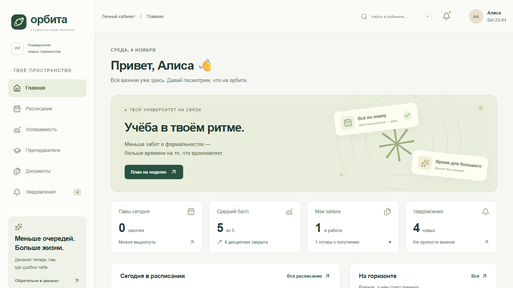
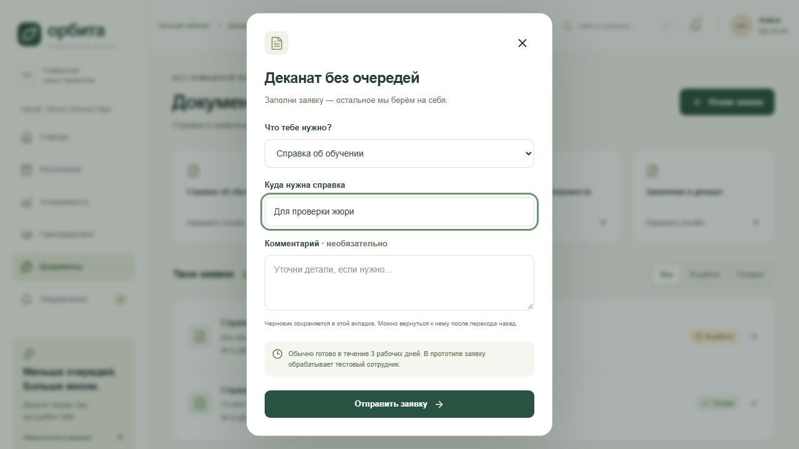
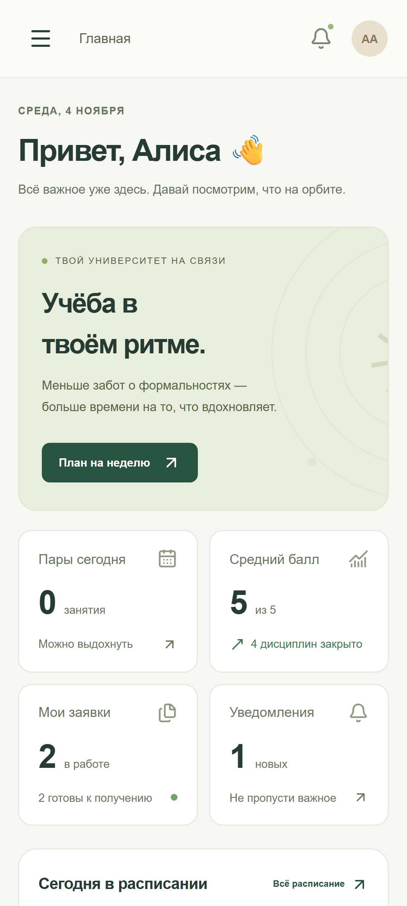

# Как создавалась «Орбита»

Дата работы: 4 ноября 2026 года, Москва.

## Проблема и идея

Студенту приходится искать расписание, оценки и ответы деканата в разных системах. «Орбита» объединяет пять обязательных задач и показывает на главной ближайший шаг: куда идти, что сдавать, готова ли справка. Это гипотеза из конкурсного ТЗ; интервью с однокурсниками не проводились и не заявляются.

Пользователь выбрал вымышленный университет и подготовку инструкций вместо регистрации хостинга. По его дополнительному требованию архитектура и важный код выполнялись GPT-6 Astra с effort xhigh.

## Инструменты и роли

- Codex Desktop: основная среда, выполнение команд и интеграция исходников.
- Основной Codex-агент: интерфейс React/CSS/SVG, интеграция, Playwright, развёртывание, документация и проверка артефактов.
- ECC Architect: первоначальное планирование границ до уточнения модели.
- GPT-6 Astra xhigh в роли ECC Architect: уточнение модели данных, контрактов, безопасности и проверок; эта роль была только для чтения.
- GPT-6 Astra xhigh в роли worker: серверная реализация NextAuth, libSQL, бизнес-правил и тестов. Worker был назначен отдельно, поскольку ECC Architect запрещает запись файлов.
- ECC Code Reviewer: независимый аудит кода, повторное ревью исправлений, проверка Web Interface Guidelines.
- ECC skills: backend-patterns, frontend-patterns, coding-standards, security-review, tdd-workflow, verification-loop. Codex Hyper использован как схема проверки и передачи задач; запись серверных файлов делегирована Astra по явному запросу пользователя.
- web-design-guidelines: актуальные правила Vercel загружались из исходного репозитория; исправлялись фокус, контраст, формы и URL состояния.
- Next.js, React, NextAuth, libSQL, bcryptjs, Zod, Lucide: библиотеки приложения.
- npm, TypeScript, ESLint, Prettier: установка, типы, статический анализ, форматирование.
- Vitest/V8: тесты сервисов, безопасности, API и callbacks авторизации; Playwright/Chromium: настоящие сценарии и скриншоты.
- Веб-доступ к официальной документации: проверка текущих API Next.js, NextAuth и libSQL.
- Python/reportlab и Poppler: создание и визуальная проверка PDF.

Другие AI-сервисы, генераторы изображений, Figma и официальные материалы вуза не использовались. Приложению не нужен API-ключ нейросети.

## Этапы и изменения

1. Прочитано полное ТЗ, выделены функциональные и конкурсные ограничения. У пользователя уточнены вуз, хостинг и модель для важного кода.
2. Выбраны единый Next.js проект, серверная авторизация и переносимая libSQL БД; согласованы DTO и HTTP-контракты.
3. Сначала написаны проверки серверных правил. Зафиксированы RED-ошибки отсутствующей реализации, затем добавлен работающий сервис.
4. Создан визуальный язык: светлый фон, тёмно-зелёная навигация, орбиты вместо фотографий, собственный SVG-знак. Структура страниц строилась вокруг задач, а не перечня внутренних систем.
5. Добавлены реальные формы, SQLite, кабинет сотрудника и цепочка уведомлений. Параллельная проверка выявила конфликт конкурентных локальных транзакций; Astra добавил общую очередь записей и регрессионный тест.
6. Независимое ревью нашло ошибки соседних недель, адресов уведомлений, среднего балла и начального типа справки. Они исправлены. Контраст повысили; мобильное меню получило inert, фокус-ловушку, Escape и восстановление фокуса. После отправки форма больше не зависит от успешного повторного GET.
7. В браузере обнаружились также неточные тестовые селекторы: число непрочитанных меняло доступное имя ссылки; карточка типа справки совпадала с существующей заявкой. Навигация получила явные имена, тесты — точные смысловые селекторы.
8. Подготовлены production standalone, Docker/VPS и Vercel инструкции, тестовые аккаунты, скриншоты и отчёт. Публикация остаётся отдельным действием владельца аккаунта по его выбору.

## Вход и хранение простыми словами

Пароль превращён в bcrypt-хеш; сервер проверяет его без хранения открытого пароля в БД. После входа браузер получает защищённую cookie. При каждом доступе сервер узнаёт владельца по этой сессии и читает только его строки. Даже если заменить ID заявки в адресе, чужая запись не выдаётся. Сотрудник имеет отдельную роль, которую сервер перепроверяет в БД.

Заявки, история и уведомления сохраняются в SQLite/libSQL. Результат обработки и уведомление записываются вместе. Локальная память процесса не является хранилищем пользовательских записей.

## Участие человека

Человек предоставил задание, выбрал вымышленный университет, отсутствие текущего хостинга и Astra xhigh. Затем уточнил регистрацию без почты, попросил два семестра, связь с преподавателями и публичный GitHub. Ручной код, интервью, публикация самого сайта и запись видео не выполнялись. Репозиторий создаёт и загружает агент по явному разрешению пользователя; владелец далее подключает хостинг, задаёт секреты, проверяет доступность из России и отправляет работу.

## Вторая итерация: iPhone SE, аккаунты и преподаватели

Пользователь прислал скриншот обрезанного заголовка. Новый Playwright-тест сначала воспроизвёл ошибку (RED): scrollWidth заголовка превышал контейнер. Причина — скрытый мобильный br и склеивание с длинным словом. Блоки заголовка, размер и перенос исправлены; проверены 320/375 px, увеличение шрифта на 50% и WebKit с профилем iPhone SE.

Предложение реальной регистрации с почтой пользователь заменил на регистрацию только вымышленных аккаунтов без подтверждения. Astra xhigh спроектировал и реализовал persona/program, отдельные учебные данные, bcrypt, уникальные логины и долговечные лимиты. SMTP и реальные контакты не добавлялись.

Тот же worker добавил семестры 2026/27, праздники, переносы и недельный API. Источники проверял основной агент. Границы семестров и сессии — вымышленная политика вуза. Добавлены каталог преподавателей и личные диалоги с ответами тестового сотрудника. Reviewer проверил валидацию формы, обновление списка диалогов, миграции и полномочия.

GitHub CLI был авторизован как AyanamiFRei. Пользователь разрешил публичный репозиторий mgimo-vibecode-orbita без БД и секретов. Перед коммитом проверяются staged-файлы; для Git используется GitHub noreply-адрес.

Первая отправка отклонена GitHub: OAuth-токен не имеет workflow scope для записи `.github/workflows/checks.yml`. Чтобы не запрашивать расширение прав ради необязательной автоматизации, тот же YAML перенесён в `tooling/github-actions/checks.yml` как готовый шаблон. Непубликовавшийся первоначальный коммит исправлен; история и код пользователя не переписывались.

## Подтверждения

`prompts.md` содержит ключевые реальные постановки задач; `verification.md` — команды и ограничения. В `screenshots` находятся реальные захваты Playwright. Ранние Figma-макеты не существовали и не имитируются; скриншоты показывают рабочую реализацию и пользовательские шаги. Неудачные варианты и исправления описаны по реальным результатам ревью и команд.

